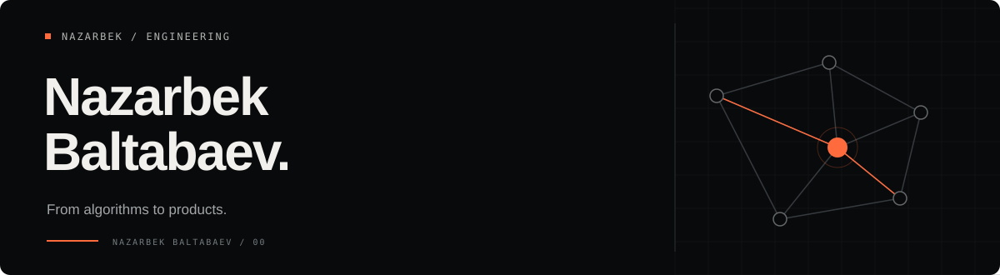

[English](README.md) · [O‘zbekcha](README.uz.md) · [Русский](README.ru.md)

# Nazarbek Baltabaev

**Full-stack engineer. Founder of KEP.uz. Yandex Cup 2025 Frontend Champion.**

I build products where the interesting work is beneath the interface: judging code, keeping a restaurant running offline, making financial rules consistent, or turning a musical score into a learning experience. Based in Uzbekistan; working across React, TypeScript, Python and Go.

## The flagship: KEP.uz

[KEP.uz](https://kep.uz/) brings programming practice, contests, learning and community into one platform. I founded it and continue to build the product and its engineering foundations.

| Registered users | Visible problems | Contests | Submissions |
| ---: | ---: | ---: | ---: |
| 9,564 | 2,101 | 374 | 436,057 |

Public platform snapshot, **26 October 2026**. [Data source](https://kep.uz/api/landing-page-statistics). These are registered users and submitted solutions, not active-user or accepted-solution counts.

The work spans a modular React client, Django services, real-time competition experiences and a judging system for running and evaluating submissions.

[Explore the platform](https://kep.uz/) · [Frontend source](https://github.com/archon1999/kep-frontend)

## Selected work

| Product | What I work on |
| --- | --- |
| [Cafe Postcode / PosCode](https://cafe-postcode.uz/) | Built end to end: restaurant POS, operations, device integration and offline synchronization. Used in **200+ branches**, based on my operating count. [Backend](https://github.com/archon1999/cafe-postcode-backend) · [POS](https://github.com/archon1999/cafe-postcode-pos-frontend). |
| Nexa / Scale TMS | Started as frontend lead; moved to senior full-stack after the MVP. React and Go work across logistics, reporting and financial workflows. |
| [cp.uz](https://cp.uz/) | Uzbek competitive-programming knowledge platform: structured learning, algorithm references and olympiad archives. [Source](https://github.com/cp-uz/cp-uz). |
| [KuyLab](https://kuylab.uz/) | Piano learning studio with MIDI playback, guided practice and personal progress. [Source](https://github.com/archon1999/kuylab). |
| [Deenly](https://deenly.uz/) | Islamic learning and worship tools with shared progress across the web and Telegram. [Source](https://github.com/archon1999/DeenlyBot). |

I also contributed to the **IOI 2026 technical environment**, including contestant Linux provisioning and debugger reliability, and worked on enterprise energy monitoring and billing interfaces at **Uzinfocom**. My current independent projects include **KEPScience**, an interactive science learning platform.

## Competitive programming

| Result | Evidence |
| --- | --- |
| **Yandex Cup 2025 — 1st, Frontend main category** | [Official leaderboard](https://new.contest.yandex.com/contests/86107/leaderboard) |
| **Codeforces Master — peak 2157** | [Odminbey](https://codeforces.com/profile/Odminbey) |
| **ICPC Uzbekistan Subregional 2018 — 1st, team** | [Official standings](https://neerc.ifmo.ru/archive/2018/uzbekistan/standings.html) |
| **ICPC Uzbekistan & Tajikistan Regional 2020 — 1st, team** | [Official standings](https://official.contest.yandex.ru/uz2020/contest/23207/standings/) |
| **ICPC Uzbekistan 2019 — 2nd, team** | [Official standings](https://neerc.ifmo.ru/archive/2019/uzbekistan/standings.html) |

[Algorithms and C++ templates](https://github.com/archon1999/competitive-programming)

## Engineering focus

- Clear domain boundaries and typed contracts between UI, services and storage.
- Correct state transitions, permissions, monetary calculations and retry behavior.
- Products that remain understandable across English, Uzbek and Russian.
- Shipping the full path: interface, backend, deployment and operational recovery.

**Frontend:** React · Angular · TypeScript · MUI  
**Backend:** Python · Django/DRF · FastAPI · Go · PostgreSQL · Redis  
**Delivery:** Docker · Linux · Nginx · CI/CD  
**Foundations:** C++ · algorithms · data structures

## Connect

[Telegram](https://t.me/archon1999) · [Email](mailto:nazarbek.baltabaev@gmail.com) · [Codeforces](https://codeforces.com/profile/Odminbey) · [FL.ru](https://www.fl.ru/users/nazarbek-baltab/portfolio/)
