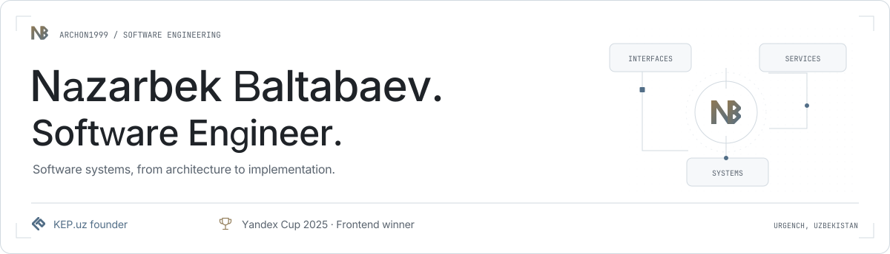
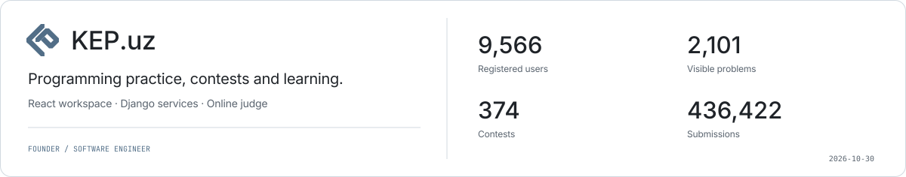
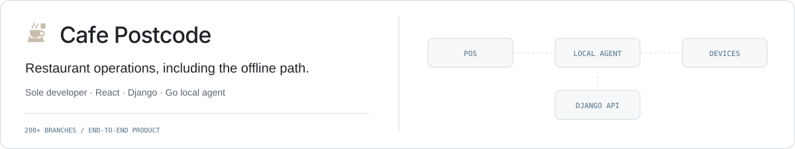
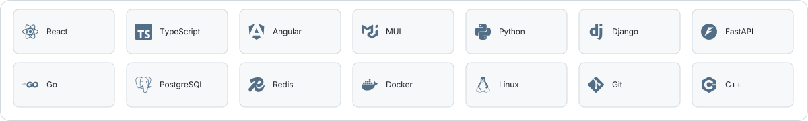
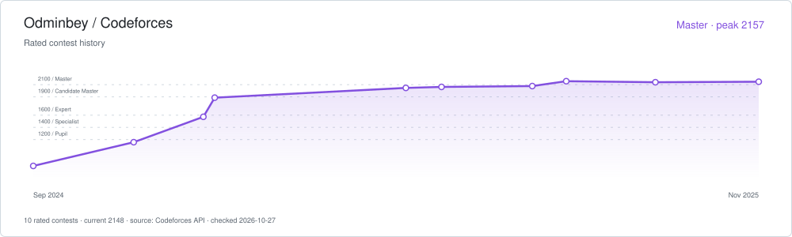
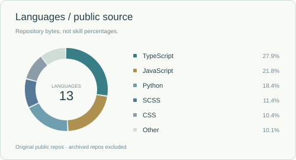
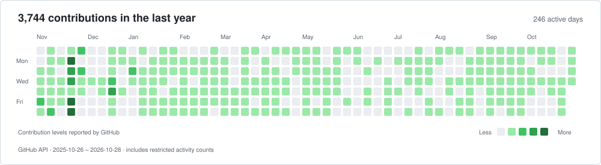
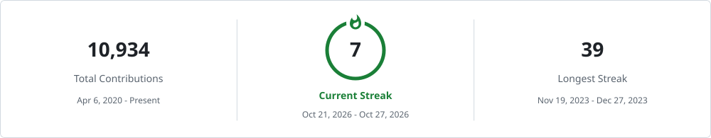

<picture><source media="(prefers-color-scheme: dark)" srcset="assets/banner-dark.svg"></picture>

[English](README.md) · [O‘zbekcha](README.uz.md) · [Русский](README.ru.md)

**Software Engineer · Основатель KEP.uz · Победитель Yandex Cup 2025 во Frontend.**

Программные системы — от архитектуры до реализации: продуктовые интерфейсы, backend-сервисы, инфраструктура проверки кода и автоматизация. Ургенч, Узбекистан.

<a href="https://new.contest.yandex.com/contests/86107/leaderboard"><picture><source media="(prefers-color-scheme: dark)" srcset="assets/badge-yandex-dark.svg"></picture></a>
<a href="https://codeforces.com/profile/Odminbey"><picture><source media="(prefers-color-scheme: dark)" srcset="assets/badge-codeforces-dark.svg"></picture></a>
<a href="https://kep.uz/"><picture><source media="(prefers-color-scheme: dark)" srcset="assets/badge-kep-dark.svg"></picture></a>

## Платформа для программирования

<picture><source media="(prefers-color-scheme: dark)" srcset="assets/kep-overview-dark.svg"></picture>

Основатель KEP.uz: React-пространство, сервисы Django и инфраструктура online judge. Публичная статистика платформы обновляется из KEP.uz.

[О проекте](https://github.com/archon1999/engineering-portfolio/blob/main/projects/kep.md) · [Код](https://github.com/archon1999/kep-frontend) · [Сайт](https://kep.uz/) · [Данные](data/products.json)

## Ресторанные системы

<picture><source media="(prefers-color-scheme: dark)" srcset="assets/cafe-overview-dark.svg"></picture>

Самостоятельно создал Cafe Postcode: POS, ресторанные процессы, интеграции устройств и офлайн-работу через локальный агент. Система используется в **200+ филиалах**.

[О проекте](https://github.com/archon1999/engineering-portfolio/blob/main/projects/cafe-postcode.md) · [Backend](https://github.com/archon1999/cafe-postcode-backend) · [POS](https://github.com/archon1999/cafe-postcode-pos-frontend) · [Admin](https://github.com/archon1999/cafe-postcode-admin-frontend)

## Проекты и инженерия

| Проект | Инженерный вклад | Ссылки |
| --- | --- | --- |
| **KEP.uz** | Рабочие пространства, соревнования, обучение и изолированная проверка кода. | [О проекте](https://github.com/archon1999/engineering-portfolio/blob/main/projects/kep.md) · [Код](https://github.com/archon1999/kep-frontend) · [Сайт](https://kep.uz/) |
| **HET Billing** | Национальный биллинг электроэнергии. Руководство 10 frontend-разработчиками. | [О проекте](https://github.com/archon1999/engineering-portfolio/blob/main/projects/het-billing.md) · [Сайт](https://cabinet.het.uz/) |
| **Nexa TMS AI** | Транспортные операции, диспетчеризация, обслуживание, расчёты и финансовые отчёты. | [О проекте](https://github.com/archon1999/engineering-portfolio/blob/main/projects/nexa.md) · [Сайт](https://nexa-tms.ai/) |
| **Cafe Postcode** | Ресторанный POS, операции, устройства и офлайн-синхронизация. Используется в 200+ филиалах. | [О проекте](https://github.com/archon1999/engineering-portfolio/blob/main/projects/cafe-postcode.md) · [Код](https://github.com/archon1999/cafe-postcode-backend) · [Сайт](https://cafe-postcode.uz/) |
| **Energo Nazorat** | Мониторинг энергетики и отчётность: интерфейсы Angular и сервисы Django. | [О проекте](https://github.com/archon1999/engineering-portfolio/blob/main/projects/energo-nazorat.md) |
| **Smart Billing 360** | Биллинг горячей и холодной воды, электроэнергии для зданий и квартир в Германии. | [О проекте](https://github.com/archon1999/engineering-portfolio/blob/main/projects/smart-billing-360.md) |
| **KuyLab** | Обучение фортепиано: MIDI, визуализация нот и пошаговая практика. | [О проекте](https://github.com/archon1999/engineering-portfolio/blob/main/projects/kuylab.md) · [Код](https://github.com/archon1999/kuylab) · [Сайт](https://kuylab.uz/) |
| **Deenly** | Арабский язык, библиотека, календарь и напоминания в вебе и Telegram. | [О проекте](https://github.com/archon1999/engineering-portfolio/blob/main/projects/deenly.md) · [Код](https://github.com/archon1999/DeenlyBot) · [Сайт](https://deenly.uz/) |
| **IOI 2026** | Linux-окружения участников, виртуальные машины, отладка и офлайн-ресурсы. | [О проекте](https://github.com/archon1999/engineering-portfolio/blob/main/projects/ioi-2026.md) · [Сайт](https://ioi2026.uz/) |
| **cp.uz** | Справочник алгоритмов на узбекском языке, учебные маршруты и архив олимпиад. | [О проекте](https://github.com/archon1999/engineering-portfolio/blob/main/projects/cp-uz.md) · [Код](https://github.com/cp-uz/cp-uz) · [Сайт](https://cp.uz/) |
| **KEPScience** | Интерактивная наука: статьи, атлас понятий, модели и учебные игры. В разработке. | [О проекте](https://github.com/archon1999/engineering-portfolio/blob/main/projects/kepscience.md) · [Сайт](https://kep.science.uz/) |

[Архитектура и все 11 проектов](https://github.com/archon1999/engineering-portfolio)

Команды и ответственность

**Newmax Group LLC:** Nexa TMS AI, Frontend Lead → Senior Full-Stack. **UZINFOCOM:** руководство frontend в HET Billing и full-stack работа над Energo Nazorat. **K-Tech (Khorezm Tech):** frontend Smart Billing 360. **IOI 2026:** технический вклад в составе HSC.

## Инженерный стек

<picture><source media="(prefers-color-scheme: dark)" srcset="assets/toolkit-dark.svg"></picture>

**Интерфейсы:** React · Angular · TypeScript · MUI · Figma 
**Сервисы и данные:** Django/DRF · FastAPI · Go · PostgreSQL · Redis 
**Инфраструктура и автоматизация:** Docker · Linux · Nginx · CI/CD · Selenium · боты 
**Основа:** C++ · алгоритмы · структуры данных

## Спортивное программирование

<picture><source media="(prefers-color-scheme: dark)" srcset="assets/yandex-journey-dark.svg"></picture>

| Сезон | Результат |
| --- | --- |
| 2023 | Полуфинал |
| 2024 | 7-е место в финале |
| [2025](https://new.contest.yandex.com/contests/86107/leaderboard) | **Победа во Frontend** |

<picture><source media="(prefers-color-scheme: dark)" srcset="assets/codeforces-dark.svg"></picture>

Другие результаты соревнований

| Соревнование | Результат |
| --- | --- |
| [Robocoders 2019](https://kun.uz/ru/news/2019/02/24/v-uzbekistane-opredelili-pobediteley-finalnogo-tura-konkursa-robocoders-2019) | 1-е место · молодёжная категория |
| [IT Park Cup 2020](https://it-park.uz/ru/itpark/news/pobediteli-chempionata-po-sportivnomu-programmirovaniyu-s-prizovym-fondom-v-30-000) | 2-е место · дивизион A |
| [ICPC Uzbekistan 2018](https://neerc.ifmo.ru/archive/2018/uzbekistan/standings.html) | 1-е место · команда |
| [ICPC Uzbekistan & Tajikistan 2020](https://official.contest.yandex.ru/uz2020/contest/23207/standings/) | 1-е место · команда |
| [ICPC Uzbekistan 2019](https://neerc.ifmo.ru/archive/2019/uzbekistan/standings.html) | 2-е место · команда |

[C++ / Алгоритмы](https://github.com/archon1999/competitive-programming) · [Codeforces / Odminbey](https://codeforces.com/profile/Odminbey)

## Активность GitHub

<picture><source media="(prefers-color-scheme: dark)" srcset="assets/github-stats-dark.svg"></picture>
<picture><source media="(prefers-color-scheme: dark)" srcset="assets/languages-dark.svg"></picture>

<picture><source media="(prefers-color-scheme: dark)" srcset="assets/activity-dark.svg"></picture>

Серии активности

<picture><source media="(prefers-color-scheme: dark)" srcset="assets/streak-dark.svg"></picture>

Карточки GitHub используют данные открытых репозиториев; доли языков отражают объём исходников. Счётчики активности могут включать итоги закрытой работы. [Инструменты и данные](PROFILE-ASSETS.md).

## Связаться

[Telegram](https://t.me/archon1999) · [Email](mailto:nazarbek.baltabaev@gmail.com) · [Codeforces](https://codeforces.com/profile/Odminbey) · [FL.ru](https://www.fl.ru/users/nazarbek-baltab/portfolio/)
