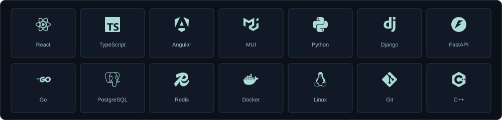

  
  
  

[English](README.md) · [O‘zbekcha](README.uz.md) · [Русский](README.ru.md)

# Nazarbek Baltabaev

**Full-stack dasturchi. KEP.uz asoschisi. Yandex Cup 2025 Frontend chempioni.**

Men interfeys ortida murakkab muhandislik masalalari yotgan mahsulotlarni yarataman: kodni tekshirish, restoranni internetsiz ishlatish, moliyaviy qoidalarni izchil qo‘llash yoki musiqiy asarni o‘rganish tajribasiga aylantirish. O‘zbekistonda yashayman; React, TypeScript, Python va Go bilan ishlayman.

## Asosiy loyiham: KEP.uz

[KEP.uz](https://kep.uz/) dasturlash mashqlari, musobaqalar, ta’lim va hamjamiyatni bitta platformada birlashtiradi. Unga asos solganman va mahsulot hamda uning texnik poydevorini rivojlantirishda davom etaman.

| Ro‘yxatdan o‘tgan foydalanuvchilar | Ochiq masalalar | Musobaqalar | Yuborilgan yechimlar |
| ---: | ---: | ---: | ---: |
| 9 564 | 2 101 | 374 | 436 057 |

**2026-yil 26-oktabr** holatidagi ochiq statistika. [Ma’lumot manbasi](https://kep.uz/api/landing-page-statistics). Bu ro‘yxatdan o‘tgan foydalanuvchilar va yuborilgan yechimlar soni; faol foydalanuvchilar yoki to‘g‘ri yechimlar soni emas.

Ishlar modulli React interfeysi, Django servislari, real vaqt rejimidagi musobaqalar va yuborilgan dasturlarni ishga tushirib baholaydigan judge tizimini qamrab oladi.

[Platformani ochish](https://kep.uz/) · [Frontend kodi](https://github.com/archon1999/kep-frontend)

## Tanlangan loyihalar

| Mahsulot | Mening ishlarim |
| --- | --- |
| [Cafe Postcode / PosCode](https://cafe-postcode.uz/) | To‘liq o‘zim yaratganman: restoran POS tizimi, operatsion boshqaruv, qurilmalar integratsiyasi va oflayn sinxronlash. O‘z hisobim bo‘yicha **200 dan ortiq shahobchada** ishlatiladi. [Backend](https://github.com/archon1999/cafe-postcode-backend) · [POS](https://github.com/archon1999/cafe-postcode-pos-frontend). |
| [HET Billing](https://reestr.uz/en/projects/1566) · UZINFOCOM | **Frontend Team Lead / Tech Lead, 05.2023–08.2025.** Milliy elektr billingi, veb kabinetlar, e-Dalolatnoma va HETK bo‘yicha 10 frontend dasturchiga rahbarlik; arxitektura, kod ko‘rigi va ishlarni muvofiqlashtirish. |
| Energo Nazorat · UZINFOCOM | **Full-Stack Engineer, 01.2024–12.2025.** Energetika monitoringi uchun Angular interfeyslari, Django endpoint’lari, ma’lumot modellari va integratsiyalar. [Rasmiy platforma konteksti](https://api-portal.gov.uz/uploads/1b137b5f-db61-f042-1ed9-8aaed22657f0_media_.pdf). |
| K-Tech · Germaniya kommunal billingi | **Angular Frontend Engineer, 09.2024–05.2025.** Bino va xonadonlar bo‘yicha issiq/sovuq suv va elektr hisobi; murakkab shakllar, jadvallar, API va navigatsiya. |
| Nexa / Scale TMS | Frontend lead sifatida boshlaganman; MVPdan keyin senior full-stack roliga o‘tganman. Logistika, hisobotlar va moliyaviy jarayonlarda React va Go bilan ishlayman. |
| [cp.uz](https://cp.uz/) | Sport dasturlashni o‘zbek tilida o‘rganish platformasi: izchil ta’lim yo‘llari, algoritmlar qo‘llanmasi va olimpiadalar arxivi. [Kod](https://github.com/cp-uz/cp-uz). |
| [KuyLab](https://kuylab.uz/) | MIDI ijrosi, bosqichma-bosqich mashqlar va shaxsiy progressga ega pianino o‘rganish studiyasi. [Kod](https://github.com/archon1999/kuylab). |
| [Deenly](https://deenly.uz/) | Sayt va Telegram o‘rtasida umumiy progressga ega islomiy ta’lim va ibodat vositalari. [Kod](https://github.com/archon1999/DeenlyBot). |

**IOI 2026 texnik muhiti**ga, jumladan ishtirokchilar uchun Linux tizimini tayyorlash va debugger ishonchliligiga hissa qo‘shganman. **Uzinfocom**da energiya monitoringi va billing tizimlari interfeyslari ustida ishlaganman. Hozirgi mustaqil loyihalarim orasida interaktiv ilmiy ta’lim platformasi — **KEPScience** ham bor.

## Texnologiyalarim

## GitHub faoliyatim

<picture><source media="(prefers-color-scheme: dark)" srcset="assets/github-stats-dark.svg"></picture>
<picture><source media="(prefers-color-scheme: dark)" srcset="assets/languages-dark.svg"></picture>

<picture><source media="(prefers-color-scheme: dark)" srcset="assets/activity-dark.svg"></picture>

Grafiklar GitHub va Codeforces ma’lumotlaridan har kuni yangilanadi. Til ulushlari ochiq kod hajmini bildiradi. Contribution soniga yopiq loyihalardagi faoliyat soni ham kirishi mumkin. [Grafiklar qanday yaratiladi](PROFILE-ASSETS.md).

## Sport dasturlash

<picture><source media="(prefers-color-scheme: dark)" srcset="assets/codeforces-dark.svg"></picture>

| Natija | Manba |
| --- | --- |
| **Yandex Cup 2025 — Frontend asosiy yo‘nalishida 1-o‘rin** | [Rasmiy natijalar](https://new.contest.yandex.com/contests/86107/leaderboard) |
| **Codeforces Master — eng yuqori reyting 2157** | [Odminbey](https://codeforces.com/profile/Odminbey) |
| **ICPC Uzbekistan Subregional 2018 — jamoaviy 1-o‘rin** | [Rasmiy natijalar](https://neerc.ifmo.ru/archive/2018/uzbekistan/standings.html) |
| **ICPC Uzbekistan & Tajikistan Regional 2020 — jamoaviy 1-o‘rin** | [Rasmiy natijalar](https://official.contest.yandex.ru/uz2020/contest/23207/standings/) |
| **ICPC Uzbekistan 2019 — jamoaviy 2-o‘rin** | [Rasmiy natijalar](https://neerc.ifmo.ru/archive/2019/uzbekistan/standings.html) |

[Algoritmlar va C++ shablonlari](https://github.com/archon1999/competitive-programming)

## Muhandislikda e’tibor beradigan jihatlarim

- Domenlar o‘rtasidagi aniq chegaralar, UI, servislar va ma’lumotlar ombori orasidagi tiplashtirilgan kontraktlar.
- To‘g‘ri holat almashinuvi, ruxsatlar, pul hisob-kitoblari va qayta urinishlar.
- Ingliz, o‘zbek va rus tillarida tushunarli mahsulotlar.
- To‘liq yetkazib berish: interfeys, backend, joylashtirish va nosozlikdan tiklash.

**Frontend:** React · Angular · TypeScript · MUI  
**Backend:** Python · Django/DRF · FastAPI · Go · PostgreSQL · Redis  
**Yetkazib berish:** Docker · Linux · Nginx · CI/CD  
**Asoslar:** C++ · algoritmlar · ma’lumotlar tuzilmalari

## Bog‘lanish

[Telegram](https://t.me/archon1999) · [Email](mailto:nazarbek.baltabaev@gmail.com) · [Codeforces](https://codeforces.com/profile/Odminbey) · [FL.ru](https://www.fl.ru/users/nazarbek-baltab/portfolio/)
